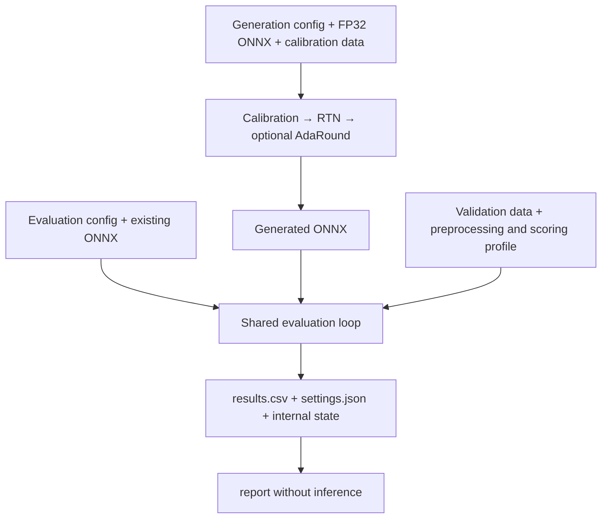

# How opennpu-quant works

`run -c` creates and evaluates INT8 models from a generation config, or evaluates existing ONNX files from an evaluation config. Both use the same inference, postprocessing, metrics and report calculations.

## Calibration data and evaluation data

Calibration inputs determine numerical ranges for quantization. Evaluation inputs and ground truth measure the finished model. Their splits and order are separate. An evaluation-only config needs no calibration data.

## 1. Preprocessing

A model recipe defines input size, color order and normalization. Preprocessing retains image size, resize ratio and padding for restoring boxes and masks. Some bundles include a CPU `preprocess.onnx` graph. Recipe inputs and network inputs can therefore differ, as listed in the [model reference](model-reference.md).

## 2. Calibration

Calibration runs representative inputs through FP32, collecting activation min/max and histograms. Range selection is separate. A percentile change can reuse matching statistics, while changing the inputs or bin count requires collecting again. See [Quantization logic](quantization.md).

## 3. Quantization

Selected ranges determine scales and zero points. The engine inserts QDQ boundaries and quantizes weights and biases. A float scale is still INT8 quantization. RTN rounds weights to integer codes. AdaRound keeps those encodings and learns rounding decisions.

## 4. Postprocessing

Detection outputs are decoded and filtered with NMS. Segmentation outputs are restored to masks. Python postprocessing can follow a CPU `postprocess.onnx` graph. Only `network.onnx` is quantized. Host graphs run on CPU in FP32.

## 5. Evaluation

`evaluation.loop.evaluate()` supplies the common sample loop for `run` and the public `evaluate()` API. `ModelEvaluator` combines postprocessing and task metrics. Classification uses the selected Top-K rule, detection uses AP, segmentation uses mIoU or mask AP, and face verification uses the full LFW pair protocol.

The default loop does not repeat every input for replay checks. Placement profiling reruns the first input in a profiled session on either device. If its outputs differ from the evaluated ones, the condition fails with an execution error. Optional raw capture and prediction storage do not change scoring. A small sample run checks execution and is kept separate from full accuracy.

## 6. Reporting

Reporting verifies saved completion evidence, pairs INT8 with a compatible FP32 result, and computes recovery as `100 × INT8 / FP32`. `results.csv` includes the primary metric and other reported metrics such as top-5 and AP50. Metric details such as segmentation pixel accuracy stay in `records.json`. `settings.json` records effective settings and diagnostics. Optional formats and full/partial tables are described in [Reports](reporting.md).

## Generation and evaluation inputs

| Input | Work performed | Model output |
|---|---|---|
| Generation config | Calibration, RTN, optional AdaRound, evaluation | Generated models under `models/` when saving is enabled, as in the presets |
| Evaluation config and catalog | Verify supplied models, then evaluate | Supplied models are used in place |

The catalog describes each model's recipe, network candidates, optional host graphs, connections, hashes and default conditions. Paths are relative to the catalog. Dataset manifests come from the user's data directory. Quantization and training settings are not required for evaluating existing ONNX files.

### What a model bundle contains

A bundle contains `network.onnx`, optional CPU host graphs, external weights when needed, and their input/output connections. Preprocessing, decoding and scoring conventions must accompany a model because the ONNX network alone does not define accuracy. See [Model bundles and recipes](models-and-data.md#model-bundles-and-recipes).

### Shared validation

Model files, external weights, inputs, labels, shapes, dtypes, finite outputs and sample counts are checked. Changed or corrupt evidence cannot authorize result reuse. Generated QDQ models are audited against their quantization parameters and boundaries. Evaluation-only runs verify the catalog's supplied assets and use the declared evaluation protocol.

Normal export checks ONNX validity, conversion and graph partitions. Finite framework differences are recorded. These checks do not establish exact agreement with historical Release models.

## Main components and responsibilities

Paths below are relative to `src/opennpu_quant/`.

| Component | Responsibility | Main modules |
|---|---|---|
| Public execution | Parse settings, select input mode, lock output and publish results | `cli.py`, `public_run.py` |
| Generation | Resolve generation policies, collect statistics, create and reuse QDQ models | `configuration.py`, `runner.py`, `run_storage.py` |
| Existing ONNX inputs | Validate catalog paths, graph roles, candidates and defaults | `evaluation_config.py` |
| Model export | Convert pinned framework sources into an ONNX bundle | `export/` |
| Models and data | Load graph connections, prepare images and preserve split order | `models/bundle.py`, `models/spec.py`, `data/` |
| Quantization | Calibration, ranges, scales, QDQ and AdaRound | `quant/`, `graph/` |
| Runtime and evaluation | Network sessions, host graphs, postprocessing and metrics | `ort/`, `models/adapter.py`, `evaluation/` |
| Reports | Verify evidence, pair FP32/INT8 and write requested tables | `report.py`, `results.py`, `raw_report.py` |

The public [Python API](api.md) exposes calibration, quantization, AdaRound and evaluation independently.

## Implementation details

### run call sequence

1. Load and validate the generation or evaluation config, apply CLI overrides and select conditions.
2. Lock the output directory and reject incompatible execution formats before publishing files.
3. Resolve model assets, input order, evaluation profile and runtime. Verify completed conditions before reusing them.
4. For a new generation condition, collect or reuse statistics and create RTN or AdaRound. Save models before evaluation when enabled.
5. Evaluate with the shared loop and save completion evidence last. Keep an interrupted condition incomplete.
6. Refresh reports while retaining the output lock. A later `report` command uses the same lock and needs no inference.

### Result reuse and resume

Identities cover model graphs, external weights, inputs and order, expected sample counts, runtime, profiles, implementation and relevant generation settings. `code_identity()` hashes packaged Python files. Generation and evaluation reuse are distinct, so a saved model can survive an evaluation failure. Changing evaluation settings follows the rules in [Reuse and caching](run-pipeline.md#reuse-and-caching).

Completed conditions can be reused. An interrupted ordinary evaluation restarts the condition. Do not edit stored hashes to force reuse.

### Execution environment

Network execution uses the requested device with `ORT_DISABLE_ALL`, HEURISTIC cuDNN search and CUDA TF32 disabled. Host graphs and Python scoring run on CPU. The CLI sets unset numerical-library thread variables to one. The API leaves these variables to its caller.

Device and library differences can change floating-point outputs. They are recorded as diagnostics and do not by themselves reject a numerical result. Runtime changes still prevent inappropriate cache reuse. GPU execution evidence does not establish cross-architecture bitwise equality.

### Evaluation profile resolution

Generation uses `ModelSpec.for_run()` to resolve recipe defaults. Evaluation configs use the catalog recipe and any explicit profile override. Both construct the same `ModelEvaluator`. The network outputs pass through host graphs, the selected Python decoder and the metric accumulator. Classification ties use `stable_topk_v1` in the public defaults.
